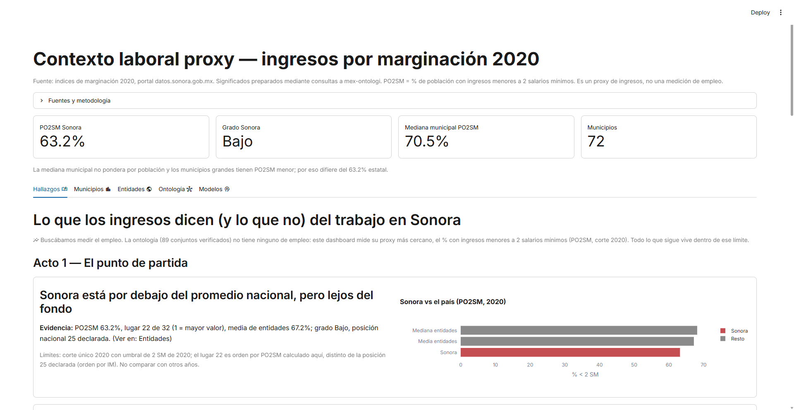
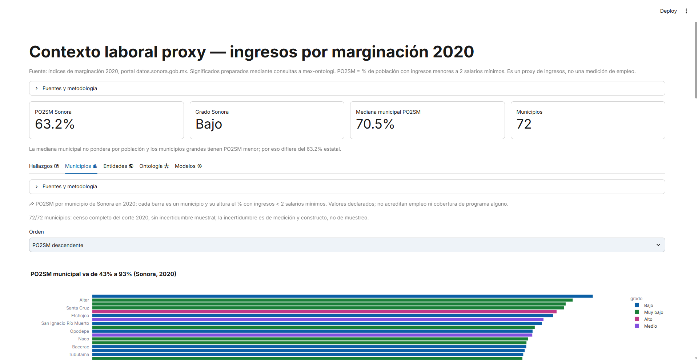
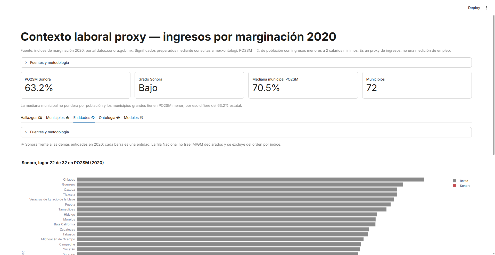
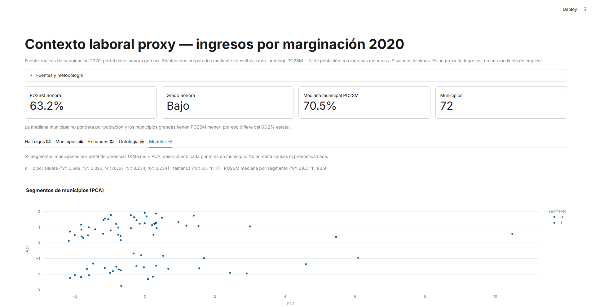

# mex-ontologi-dashboards

**Datos abiertos de Sonora, explicados con gráficos, historias y evidencia de origen.**

Este repositorio reúne dashboards de Salud, Educación, Seguridad y contexto de ingresos. Cada app permite explorar registros publicados, seguir un recorrido de hallazgos y consultar los significados y límites documentados mediante [MEX-Ontologi](https://github.com/MJVNOR/mex-ontologia).

**La fuente de los datos es el [Portal de Datos Abiertos del Estado de Sonora](https://datos.sonora.gob.mx/).** Los archivos, metadatos y diccionarios pertenecen a las publicaciones de las dependencias y organizaciones responsables de cada conjunto. Los filtros, agregaciones, historias y resultados de modelos de este repositorio son productos derivados.

[Explorar dashboards](#dashboards) · [Cómo leerlos](#cómo-leer-los-resultados) · [Ontología y procedencia](#ontología-y-procedencia) · [Uso local](#uso-local) · [Skills](#skills-para-análisis-y-dashboards)

## Dashboards

| Dashboard | Pregunta que guía la exploración | Abrir |
|---|---|---|
| **Salud en Hermosillo** | ¿Cómo se distribuyen las atenciones y qué permiten interpretar los registros de salud? | [Ver dashboard](https://mjvnor-mex-ontologi-dashbo-dashboardshermosillo-saludapp-le2l94.streamlit.app/) |
| **Educación en Hermosillo** | ¿Qué muestran las becas y los cortes institucionales sobre matrícula, reprobación y trayectoria? | [Ver dashboard](https://mex-ontologi-dashboards-zqt8qvqfwwbacguuimtvwz.streamlit.app/) |
| **Seguridad en Sonora** | ¿Cómo cambian los registros por territorio y periodo, y qué diferencias hay entre sus unidades de conteo? | [Ver dashboard](https://mex-ontologi-dashboards-plduatjh2dn6pwcct3cwku.streamlit.app/) |
| **Contexto laboral proxy: ingresos** | ¿Cómo se distribuye el indicador de ingresos PO2SM y cómo se relaciona con los perfiles de marginación? | [Ver dashboard](https://mex-ontologi-dashboards-cuxm5s9hfsjkfgabdcet4t.streamlit.app/) |

### Salud: atención, población y límites de las series

[App](dashboards/hermosillo-salud/app.py). Incluye series anuales, urgencias y egresos, consulta externa, nacimientos y defunciones, vigilancia epidemiológica, tasas preparadas con denominadores poblacionales y un apartado de pronóstico.

La pestaña **Historia** organiza los hallazgos y sus límites; **Ontología** permite consultar significados y evidencia. Los servicios, registros de residencia y registros de atención requieren interpretaciones distintas. Las estimaciones de modelos se presentan con sus métricas y advertencias.

### Educación: becas y cortes institucionales

[App](dashboards/educacion-hermosillo/app.py). Reúne becas con filtro de Hermosillo, información institucional de la Universidad Tecnológica de Hermosillo y capacitación de la SEC. Permite explorar importes, matrícula, reprobación, aprovechamiento y series de ingreso, egreso y titulación.

**Hallazgos** ofrece el recorrido narrativo. **Modelos** reúne predicción de riesgo e irregularidad, segmentación, modelos estadísticos y explicaciones SHAP. Las series de trayectoria son cortes; no acreditan el seguimiento de las mismas personas ni tasas de transición de cohortes.

### Seguridad: varias fuentes, varias unidades de conteo

[App](dashboards/seguridad-sonora/app.py). Incluye **Historia**, mapa municipal, comparación de delitos, víctimas, llamadas al 911, personas detenidas y desaparecidas, modelos y ontología.

El recorrido distingue los periodos y alcances de las fuentes. Los conteos municipales, las víctimas y las llamadas se leen como series diferentes. Los modelos incluyen agrupaciones por perfil de volumen, detección de observaciones atípicas y predicción con métricas de evaluación y explicaciones SHAP.

### Ingresos y marginación: un contexto, no una medición de empleo

[App](dashboards/marginacion-ingresos/app.py). Explora el corte de marginación 2020 mediante **Hallazgos**, municipios, entidades, ontología y modelos. Compara el indicador PO2SM, perfiles de carencias, agrupaciones descriptivas y una regresión exploratoria con explicación del modelo.

**Este dashboard no mide empleo, vacantes, colocaciones ni desempleo.** PO2SM se utiliza como indicador de contexto de ingresos; las asociaciones territoriales y los grupos del modelo no establecen causas.

### Vistas del dashboard de contexto laboral proxy






## Cómo leer los resultados

1. **Empieza por Historia o Hallazgos.** Revisa la pregunta, el gráfico y el límite de cada interpretación; después explora las pestañas temáticas.
2. **Comprueba población y periodo.** Un registro de residencia, una atención y un dato institucional no representan necesariamente el mismo universo. Los periodos parciales se leen con sus advertencias.
3. **Distingue observaciones y estimaciones.** Las predicciones, los grupos y las anomalías son resultados de modelos. Revisa las métricas, la referencia de comparación y el método de evaluación.
4. **Lee las tasas junto a su denominador.** Su interpretación depende de la compatibilidad territorial, temporal y poblacional. Una tasa derivada no acredita cobertura completa.
5. **Consulta la evidencia.** «Fuentes y metodología» y «Ontología» muestran la información disponible. SHAP explica contribuciones a una predicción; no demuestra causalidad.

Las historias presentan resultados y preguntas abiertas. La ausencia de evidencia, la cobertura desconocida y las limitaciones de los modelos forman parte de la lectura.

## Ontología y procedencia

La ontología aporta el contexto para localizar e interpretar fuentes: conjuntos, recursos, estructuras, variables documentadas y estados de correspondencia. Los valores numéricos de los dashboards proceden de los archivos del portal.

El proceso de preparación consulta el grafo, recupera las fuentes seleccionadas, transforma sus datos y publica artefactos con evidencia. La selección y las transformaciones también incluyen configuración explícita y código específico de cada tema; no se presenta como generación automática de dashboards.

| Archivo o carpeta | Qué permite revisar |
|---|---|
| [config/recursos.json](config/recursos.json) | Identificadores de fuentes seleccionadas y nombres locales. |
| [config/artefactos.json](config/artefactos.json) | Fuentes, hojas, filtros y transformaciones declaradas para los artefactos registrados. |
| `data/ontologia_*.json` y `data/significados_*.csv` | Consultas, significados, IRI, estados y huecos documentales recuperados. |
| `data/descargas_*.json` | URL, fecha de descarga y huellas de las fuentes registradas. |
| `data/procedencia_*.json` | Relación entre artefactos, fuentes, transformaciones y evidencia disponible. |
| [data/tidy/](data/tidy/) | Tablas de consumo con nombres normalizados y su [diccionario de datos](data/tidy/diccionario_datos.csv). |
| [data/modelos/](data/modelos/) y `data/seg/` | Modelos, métricas e inferencias preparadas; Seguridad conserva también artefactos intermedios y modelos propios. |

Los manifiestos indican el alcance de la evidencia de cada artefacto. Tener un archivo de procedencia no certifica que toda su documentación esté completa: los huecos se conservan. La fecha de descarga, la de extracción, la de generación y la de carga de ontología son distintas; una fecha de carga no documentada permanece como `null`.

### Contrato de consulta

Los agentes siguen [AGENTS.md](AGENTS.md). El acceso al grafo es de solo lectura mediante el MCP **`mex-ontologia`**, configurado en [opencode.json](opencode.json). Si no está disponible, se utiliza exclusivamente la CLI canónica de MEX-Ontologi.

El MCP expone `onto_query`, `onto_stats`, `onto_status`, `onto_validate` y `onto_shacl`. El lanzador y la CLI comparten un backend persistente por almacén, con sesiones independientes para los clientes. Las consultas libres requieren `LIMIT` entre 1 y 2000.

Una correspondencia candidata es una hipótesis. El estado semántico de una variable es distinto del estado del enlace con una columna, y una correspondencia revisada no autoriza por sí sola un cruce. Los cruces se evalúan mediante `MEX-Ontologi/scripts/consultar_cruces.py`; no se leen archivos TTL ni se abre directamente el motor.

## Uso local

Requiere **Python 3.12** y **uv**. Para abrir los dashboards con los artefactos incluidos:

```powershell
uv sync

# Ejecuta la app que quieras explorar:
uv run streamlit run dashboards/hermosillo-salud/app.py
uv run streamlit run dashboards/educacion-hermosillo/app.py
uv run streamlit run dashboards/seguridad-sonora/app.py
uv run streamlit run dashboards/marginacion-ingresos/app.py
```

Cada comando de Streamlit inicia una app; ejecútalos individualmente o en terminales separadas. La visualización utiliza los artefactos preparados y no necesita una conexión al MCP.

### Actualizar fuentes y artefactos

La preparación sí requiere el repositorio MEX-Ontologi y su almacén cargado. Se busca como carpeta hermana; para otra ubicación, define `MEX_ONTOLOGIA_DIR`. Configura el MCP con:

```powershell
uv run python scripts/configurar_mcp.py
```

Ejemplo de actualización de Salud, ejecutando cada paso solo cuando el anterior termine correctamente:

```powershell
uv run python scripts/extraer_significados.py --tema salud
uv run python scripts/descargar_fuentes.py --tema salud
uv run python scripts/preprocesar_hmo.py
```

El extractor usa MCP por defecto; `--transporte cli` selecciona explícitamente la alternativa canónica. `--tema todos` exporta Salud, Educación, Marginación y Población. Seguridad utiliza `scripts/extraer_evidencia.py --tema seg`.

| Tema | Descarga mediante helper CKAN autorizado | Preparación principal |
|---|---|---|
| Salud | `scripts/descargar_fuentes.py --tema salud` | `scripts/preprocesar_hmo.py` |
| Educación | `scripts/descargar_fuentes.py --tema edu` | `scripts/preprocesar_edu.py` |
| Marginación | `scripts/descargar_fuentes.py --tema marginacion` | `scripts/preprocesar_marginacion.py` |
| Población | `scripts/descargar_fuentes.py --tema poblacion` | `scripts/preprocesar_poblacion.py` |
| Seguridad | `scripts/descargar_fuentes.py --tema seg` | `scripts/preprocesar_seg.py` y después `scripts/tidy_seg.py` |

Las rutas de la tabla se ejecutan con `uv run python`, tras exportar la evidencia del tema. `tidy_seg.py` también prepara tablas de vigilancia, por lo que requiere los artefactos de Salud. Las descargas CKAN se canalizan por `MEX-Ontologi/scripts/descargar_ckan.py`, que conserva el `User-Agent` requerido por el portal. Los archivos crudos permanecen fuera de Git según [.gitignore](.gitignore).

Actualizar las fuentes no reentrena automáticamente todos los modelos. Los scripts `modelos_salud.py`, `modelos_edu.py`, `modelos_seg.py`, `predecir_seg.py` y `modelos_marginacion.py` preparan los modelos e inferencias de cada tema. `inferencia_statsmodels.py`, `inferencia_series.py`, `sarimax_salud.py` y `tasas_poblacion.py` generan análisis adicionales. Revisa sus entradas y salidas antes de regenerarlos; conserva las métricas y actualiza la procedencia de los artefactos afectados.

### Verificar una actualización

```powershell
uv run python -m unittest discover -s tests -v
uv run python scripts/verificar.py --base origin/main
```

El verificador compara los artefactos existentes en la revisión base, revisa las huellas de procedencia contempladas en su código y ejecuta las cuatro apps. Guarda el resultado en [reports/verificacion.json](reports/verificacion.json). Si cambias deliberadamente los datos, revisa las diferencias frente a una revisión anterior conocida; la igualdad de archivos y la ejecución correcta de las apps no certifican la validez de las conclusiones.

## Crear un dashboard nuevo

1. Define una pregunta y el universo que puede responderla: población, territorio, periodo y unidad de conteo.
2. Consulta la ontología y selecciona fuentes por sus identificadores, significados y evidencia.
3. Descarga mediante el helper autorizado y registra hojas, filtros, transformaciones y huecos.
4. Prepara los artefactos, evalúa los modelos que utilices y construye la app en `dashboards/<tema>/app.py`.
5. Añade un recorrido de hallazgos con gráficos y límites, la evidencia de procedencia y su entrada en este README.

## Publicación

[Streamlit Community Cloud](https://streamlit.io/cloud) utiliza una app por archivo principal. Las cuatro rutas están en los enlaces de código de la sección [Dashboards](#dashboards).

Publica las dependencias de [requirements.txt](requirements.txt), los archivos de las apps y todos los Parquet, CSV y JSON que consumen, incluidos inferencias, métricas y procedencia. El runtime publicado utiliza esos artefactos; no necesita descargar datos ni acceder al repositorio de ontología.

## Skills para análisis y dashboards

Estas skills se utilizan en Codex y OpenCode para preparar, interpretar y comunicar
los análisis. Su instalación es a nivel de usuario:

| Skill | Uso | Fuente |
|---|---|---|
| `exploratory-data-analysis` | Explorar datos, faltantes y distribuciones antes del análisis. | [K-Dense](https://github.com/K-Dense-AI/scientific-agent-skills/tree/main/skills/exploratory-data-analysis) |
| `validate-data` | Revisar cálculos, agregaciones, sesgos y respaldo de las conclusiones. | [Anthropic](https://github.com/anthropics/knowledge-work-plugins/tree/main/data/skills/validate-data) |
| `statistical-analysis` | Seleccionar métodos estadísticos e interpretar tendencias, correlaciones e incertidumbre. | [Anthropic](https://github.com/anthropics/knowledge-work-plugins/tree/main/data/skills/statistical-analysis) |
| `polars` | Preparar tablas y ejecutar filtros, transformaciones y agregaciones eficientes. | [K-Dense](https://github.com/K-Dense-AI/scientific-agent-skills/tree/main/skills/polars) |
| `data-visualization` | Elegir gráficos adecuados y mejorar escalas, etiquetas, colores y accesibilidad con Plotly, matplotlib y seaborn. | [Anthropic](https://github.com/anthropics/knowledge-work-plugins/tree/main/data/skills/data-visualization) |
| `data-storytelling` | Construir una narrativa con pregunta central, contexto, hallazgos verificables y cierre; ordenar gráficos y explicar sus límites sin inventar causas. | [wshobson/agents](https://github.com/wshobson/agents/tree/main/plugins/business-analytics/skills/data-storytelling) |
| `scientific-critical-thinking` | Interpretar resultados y evaluar la solidez de la evidencia, los sesgos y la incertidumbre; distinguir lo observado de las conclusiones y explicitar qué no se puede afirmar. | [K-Dense](https://github.com/K-Dense-AI/scientific-agent-skills/tree/main/skills/scientific-critical-thinking) |

### Modelos predictivos y machine learning

También están disponibles las siguientes skills para incorporar modelos cuando
el análisis y la evidencia lo permitan:

| Skill | Uso | Fuente |
|---|---|---|
| `scikit-learn` | Entrenar y evaluar regresión, clasificación y agrupamiento mediante pipelines y validación cruzada. | [K-Dense](https://github.com/K-Dense-AI/scientific-agent-skills/tree/main/skills/scikit-learn) |
| `statsmodels` | Ajustar modelos estadísticos y pronósticos temporales con diagnóstico e incertidumbre. | [K-Dense](https://github.com/K-Dense-AI/scientific-agent-skills/tree/main/skills/statsmodels) |
| `shap` | Explicar y auditar la contribución de las variables a las predicciones, sin atribuir causalidad. | [K-Dense](https://github.com/K-Dense-AI/scientific-agent-skills/tree/main/skills/shap) |

### Instalación para ambos agentes

```powershell
npx --yes skills add K-Dense-AI/scientific-agent-skills --skill exploratory-data-analysis polars scientific-critical-thinking --agent codex opencode --global --yes
npx --yes skills add anthropics/knowledge-work-plugins --skill validate-data statistical-analysis data-visualization --agent codex opencode --global --yes
npx --yes skills add K-Dense-AI/scientific-agent-skills --skill scikit-learn statsmodels shap --agent codex opencode --global --yes
npx --yes skills add wshobson/agents --skill data-storytelling --agent codex opencode --global --yes
```

Las skills aportan instrucciones y recursos para los agentes; las dependencias
de Python se instalan por separado y los modelos se entrenan o cargan según el
caso. No son requisitos del runtime publicado. Los modelos se evalúan con datos
reservados y los pronósticos respetan el orden temporal para evitar filtración
de información futura.

Su uso mantiene el contrato de la ontología: consultas por MCP o la CLI
canónica, evidencia trazable y evaluación de cruces mediante
`MEX-Ontologi/scripts/consultar_cruces.py`.
